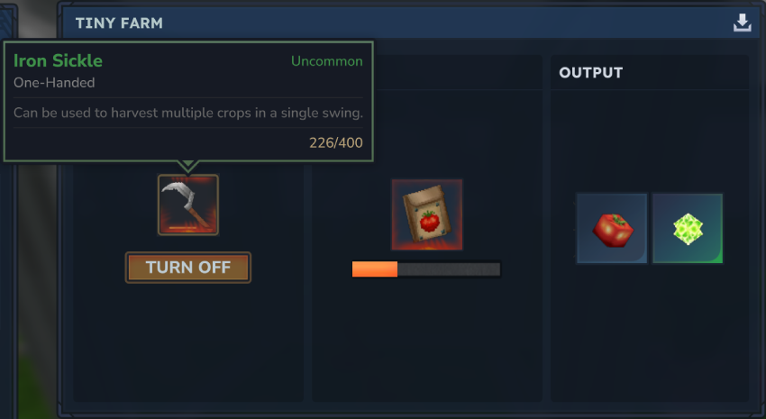
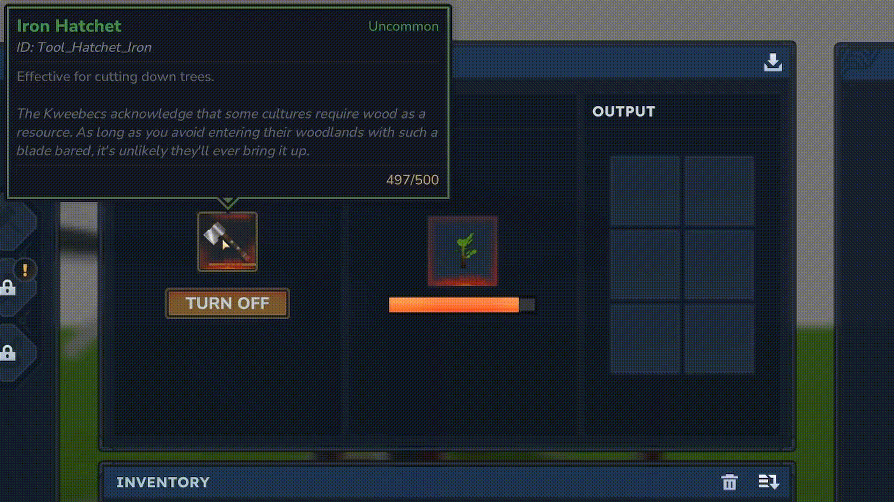

# Tiny Farms



Compact upgradable farm machines: process any sapling into logs and sticks,
powered by your tools, not fuel.

---

## Features

- One machine, every sapling: 34 sawing recipes, each sapling yields its own
  tree's trunks plus sticks (softwood/spruce yields planks, like the vanilla resource)
- Berry farming: red, winter and wet berry bushes produce berries
- Crop farming: plant a crop seed (wheat, carrot, corn, potato, pumpkin and 9 more) and get that crop, with a chance of bonus Life Essence
- Tool-powered: the fuel slot takes any tool, each finished cycle burns a bit of
  its durability, the input itself is never consumed
- Your tools never break: the machine stops at 1 durability and leaves the tool intact
- Four upgrade tiers: Iron, Thorium, Cobalt and Adamantite
  - Thorium: +2 output slots
  - Cobalt: 20% faster crafting
  - Adamantite: +2 output slots and 25% faster crafting
- Transparent block: watch the input grow inside as it processes



## Tools

- Hatchet: saws saplings into logs and sticks
- Sickle: harvests berries from berry bushes and crops from crop seeds.

## Compatibility

- Hytale `release` 0.7.x (built and tested against 0.7.7)

## Installation

1. Download the latest `TinyFarms-<version>.jar`
2. Put it in your server's `mods` folder
3. Restart the server

## Building

```
./gradlew build
```

The jar ends up in `build/libs/`. The build compiles against `HytaleServer.jar` from your Hytale install; set `patchline` in `gradle.properties` (default `release`) or pass `-Phytale_home=<path>` for a custom install location.

---

# Contributing

Suggestions, ideas, and feedback are welcome.

---

# Socials

### X: [@MarggxDev](https://l.marggx.dev/x)

### Discord: [Marggx](https://l.marggx.dev/discord)

### Reddit: [Marggx](https://l.marggx.dev/reddit)

### YouTube: [Marggx](https://l.marggx.dev/yt)

### Patreon: [Marggx](https://l.marggx.dev/patreon)
